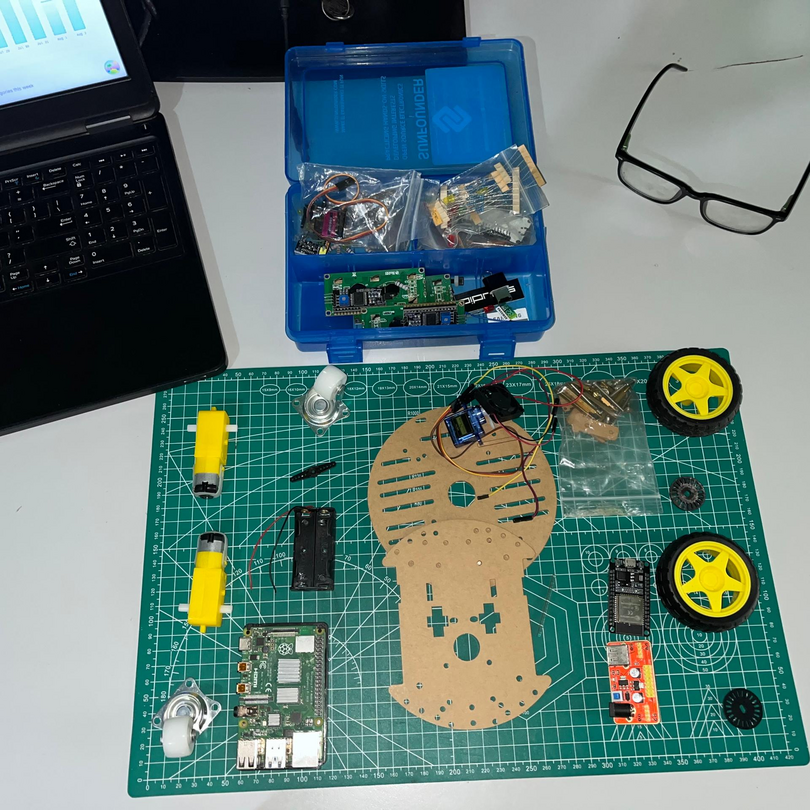
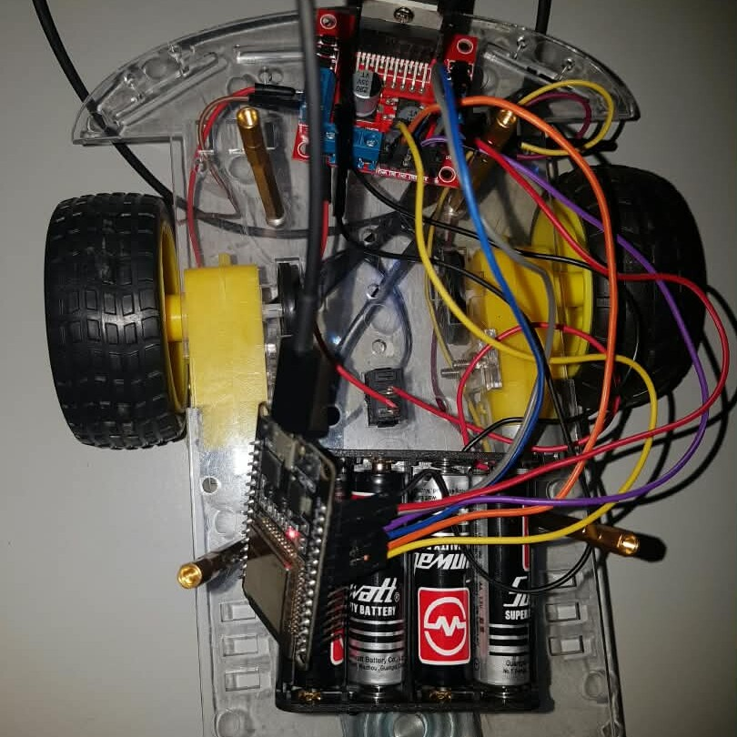

# robocar

### A remote controlled robot car made with esp32 + raspberry pi. (WIP)
<p align="center">
  
  
</p>

- **Version 1 (this code):** drive the car from a phone over Wi-Fi. The ESP32 serves the control page and takes commands over a WebSocket.
- **Version 2 (planned):** drive it from anywhere on the web, with live video from the Pi camera, using a Go + Datastar server on the Raspberry Pi.

## Hardware

ESP32 DevKit, L298N motor driver (HW-095), two TT gear motors, 4×AA pack with a switch for the motors, and a USB power bank for the ESP32.

| ESP32   | L298N | Job                    |
|---------|-------|------------------------|
| GPIO 25 | ENA   | Left motor speed (PWM) |
| GPIO 26 | IN1   | Left motor direction   |
| GPIO 27 | IN2   | Left motor direction   |
| GPIO 14 | IN3   | Right motor direction  |
| GPIO 33 | IN4   | Right motor direction  |
| GPIO 13 | ENB   | Right motor speed (PWM)|
| GND     | GND   | Shared ground          |

Take the ENA and ENB jumpers off the L298N, or the speed control won't work.

## Build and flash

Needs [arduino-cli](https://arduino.github.io/arduino-cli/) with the ESP32 core and two libraries:

```bash
arduino-cli core install esp32:esp32
arduino-cli lib install "ESP Async WebServer@3.12.1" "Async TCP@3.6.1"
```

Then:

```bash
make secrets   # creates firmware/robocar/secrets.h; put your Wi-Fi details in it
make flash     # compiles and uploads over USB
make monitor   # serial output, shows the car's address
```

The car joins your home Wi-Fi and is at `http://robocar.local` (or the IP printed on the serial monitor). If it can't reach your Wi-Fi within 10 seconds, it starts its own `RoboCar` hotspot instead: join it and open `http://192.168.4.1`.

Tuning lives in [`firmware/robocar/config.h`](firmware/robocar/config.h): flip `INVERT_LEFT` / `INVERT_RIGHT` if a wheel spins backwards, set `SWAP_SIDES` if left and right are swapped, and raise `MIN_DUTY` if the car won't move at low speed.

## Control protocol

Plain text over a WebSocket at `/ws`, one command per message:

| Command                   | Meaning                                                     |
|---------------------------|-------------------------------------------------------------|
| `drive <throttle> <steer>` | Both -100..100. Repeat at least every 400 ms or the car stops. |
| `stop`                    | Stop now.                                                   |
| `ping <n>`                | Car replies `pong <n>`.                                     |

The car also stops when the controlling page disconnects.
